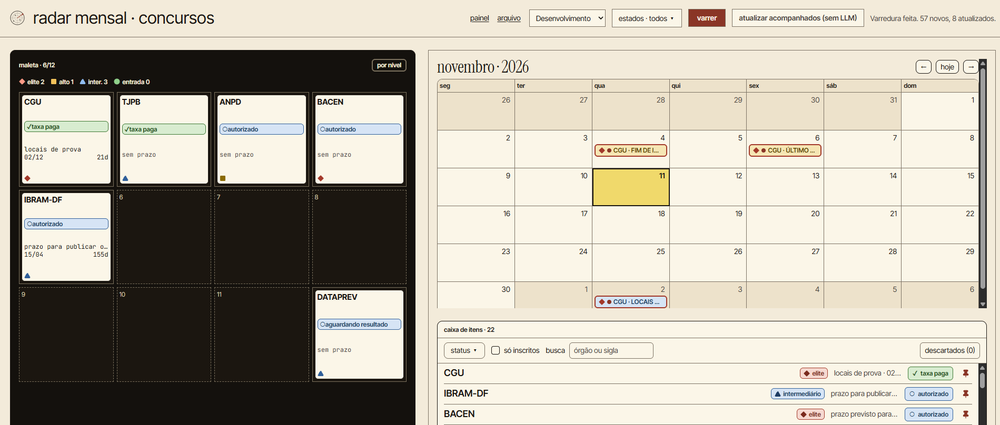
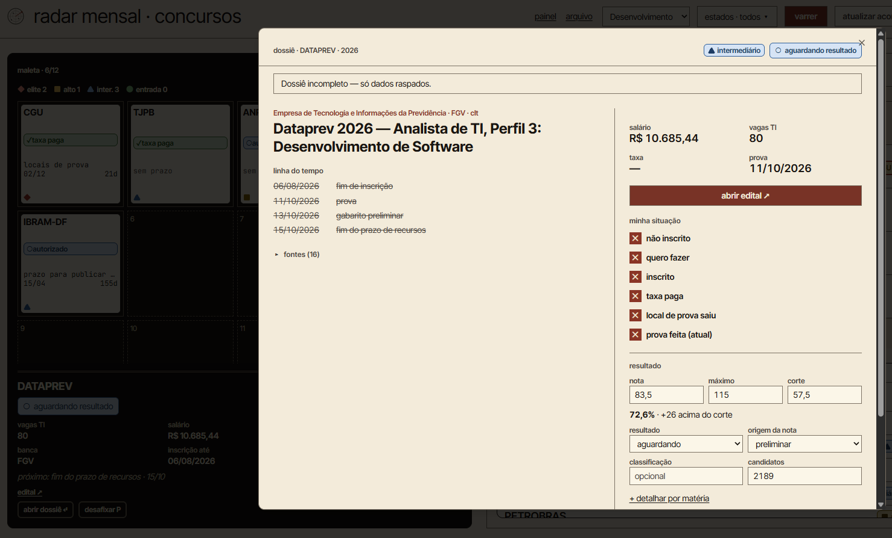
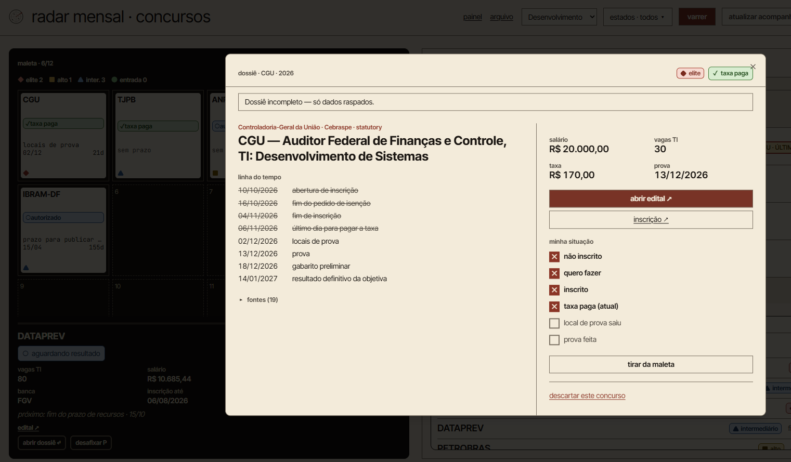

# Radar Mensal · Concursos

A personal survival-kit for tracking Brazilian public-sector IT hiring exams (*concursos públicos de TI*). Pick an IT area, hit **sweep**, and the app scrapes a handful of sources, turns each contest into a dossier, and shows everything on a calendar and in a 12-slot "attaché case" (Resident Evil-style inventory) for the ones that matter.



Single-user by design — there's no sign-up, no SaaS, no other accounts. It's built for one person to track their own exam applications.

> This repo previously hosted "Radar Hub", an unrelated SaaS-idea-curation pipeline. That product was discontinued on 2026-09-15 and nothing of it remains in the current codebase or docs.

## Why

IT contests are scattered across aggregator sites and official pages, each with its own dates: registration, fee payment, exam venues, exam day, answer key, results. Miss the fee deadline and the exam is gone. The radar pulls everything into one place, puts every deadline on a calendar, shows which data is still missing from each dossier, and records where each field came from.

## What it does

1. Pick an IT area (development, data, infrastructure, security, support, IT governance, or all) and the states you care about.
2. Hit **sweep**. The app scrapes its sources, filters by area keywords, deduplicates, and creates/updates contests.
3. For contests with gaps in their data, an LLM with web search fills in the missing fields and writes a short dossier — this step is entirely optional (see [Cost model](#cost-model)).
4. The screen tracks progress via polling and updates the calendar, the item list, and the attaché case.
5. Pin up to 12 contests to the attaché case and track your own status in each dossier (interested, registered, fee paid, exam venue out, exam taken) — and, after the exam, your score against the cut-off. Contests you stop following can be dismissed, and an archive page keeps the ones off the desk.

There's no scheduled scraping and no email. Refreshing a contest's data just means sweeping its area again.

The app works fully without an `ANTHROPIC_API_KEY` — sweeping still scrapes and populates the screen, it just skips the LLM enrichment step (`enrichment_status = skipped`). No screen breaks because of a missing key.

## Screenshots

**Dossier after the exam.** Timeline with past events struck through; salary, vacancies, fee and exam date; a link to the edital; your status checklist; and score tracking against the cut-off. The banner shows this dossier came from scraping only, with no LLM enrichment.



**Dossier before the exam.** Upcoming dates (exam venues, exam day, preliminary answer key, final result) and the list of sources behind the dossier.



## Highlights

- **Queued pipeline with failure isolation.** A sweep is a `Bus::chain` of four jobs. If one scraping adapter fails, the error goes to `search_runs.meta.errors` and the sweep carries on with the other sources.
- **LLM behind a provider interface.** Jobs and controllers never call an SDK directly — only `LlmProvider`. `AnthropicProvider` uses the Messages API with the server-side `web_search` tool; `NullProvider` covers the no-key case, so every screen works with zero LLM.
- **Structured output as a contract.** The enrichment agent must answer with JSON that `DossierValidator` checks against the schema in [`docs/agents/dossie.md`](docs/agents/dossie.md): unknown fields are rejected, and every field needs a source URL and a confidence level (`high`/`medium`/`low`). Validation errors are sent back to the model for one retry; a second failure marks the contest `enrichment_status = failed` and nothing is merged.
- **Source-priority merge with provenance.** `ContestMerger` writes field by field. Official sources (edital, exam board, DOU, `.gov.br`) beat aggregators and the seed, which beat LLM answers without an official source, and each field's origin is recorded in `field_sources`.
- **No LLM for mechanical logic.** Deduplication, effective status, pinning and merging are plain PHP, covered by Pest tests.
- **Cost visibility.** Every LLM call logs input/output tokens and the number of web searches into `search_runs.meta`.
- **AI-assisted, spec-driven development.** Built with Claude Code working from [`CLAUDE.md`](CLAUDE.md) (non-negotiable rules: scope per session, LLM only through the provider, the JSON contract, source priority) and the specs in [`docs/`](docs/) — product spec, data model, pipeline and a per-session execution plan — across 11 merged pull requests.

## Architecture

```
[choose area + states, hit sweep]
              │
     POST /sweeps  →  SearchRun(queued)  →  Bus::chain
              │
 1. HarvestSourcesJob     scrape each enabled source → raw_listings
 2. NormalizeListingsJob  filter by area → normalize → dedup → upsert contests
 3. EnrichContestsJob     pick contests with gaps → EnrichContestJob for each, in sequence
 4. FinalizeRunJob        recompute status/events, unpin expired, close the run
              │
     GET /sweeps/{run}  (polling, 3s)  →  front-end updates
```

A source adapter failing doesn't fail the whole run — the error is recorded in `search_runs.meta.errors` and the sweep continues with the other sources. Enrichment runs sequentially on purpose, so `radar:sweep` and the `SweepController` share the same code path.

```
┌──────────────── Laravel 13 monolith ────────────────┐
│                                                       │
│  Inertia + React 19 (resources/js)                   │
│    ├─ radar/index — table (calendar + item box)      │
│    │                and case (pinned slots + dossier) │
│                                                       │
│  Controllers (app/Http/Controllers/Radar)            │
│  Services (app/Services/Radar)                       │
│    ├─ Sources/*          scraping adapters           │
│    ├─ ContestNormalizer  pure text → structured data │
│    ├─ ContestMerger      field-by-field merge + rules │
│    ├─ ContestStatusResolver, PinService, LlmProvider  │
│                                                       │
│  Jobs (app/Jobs/Radar) — queued via QUEUE_CONNECTION  │
│                                                       │
│  PostgreSQL                                           │
└───────────────────────────────────────────────────────┘
```

See [`docs/`](docs/) for the full spec, data model, pipeline details, and the seed format. `docs/04-plano-execucao.md` tracks what's been built per work session.

## Stack

| Layer | Tech |
|---|---|
| Backend | Laravel 13 (PHP 8.3+) |
| Frontend | Inertia.js + React 19 + TypeScript + Tailwind 4 |
| Database | PostgreSQL |
| Queue | Laravel queues (`database` driver by default), sweeps as a `Bus::chain` |
| Scraping | Laravel HTTP client + `symfony/dom-crawler` + `symfony/css-selector` |
| LLM (optional) | Anthropic Messages API with server-side `web_search`, default model `claude-haiku-4-5-20251001` |
| Quality | Pest (109 tests), PHPStan, Pint, ESLint, Prettier, `tsc --noEmit` |
| CI | GitHub Actions on every push to `main` and `develop` |
| Deploy | Single VPS, queue worker under Supervisor |

## Getting started

```bash
# 1. Clone and install
git clone https://github.com/emanuelbrebal/monthly-radar
cd monthly-radar
composer install
npm install

# 2. Configure environment
cp .env.example .env
php artisan key:generate
# Edit .env: DB_*, RADAR_USER_EMAIL/RADAR_USER_PASSWORD (the app's only login),
# and optionally ANTHROPIC_API_KEY for LLM enrichment.

# 3. Database (creates the schema and seeds the one user + a sample of contests)
createdb monthly_radar
php artisan migrate:fresh --seed

# 4. Run
php artisan serve
npm run dev
```

Sign in with `RADAR_USER_EMAIL`/`RADAR_USER_PASSWORD`. Public registration is disabled (`Features::registration()` is off in Fortify) — the only user comes from the seeder.

To actually process a sweep you also need a queue worker running (jobs are dispatched via `QUEUE_CONNECTION`, `database` by default):

```bash
php artisan queue:work
```

### Local on Windows

Notes for running on Windows 11 (PowerShell) with a local PostgreSQL:

- **Postgres password:** PostgreSQL rejects empty passwords on `127.0.0.1`. Set `DB_PASSWORD` in `.env` and create the database once with `psql -U postgres -c "CREATE DATABASE monthly_radar"` (`psql` lives in `C:\Program Files\PostgreSQL\<version>\bin`, usually not on `PATH`).
- **SSL for scraping:** PHP on Windows ships without a CA bundle, so `radar:source`/`radar:sweep` fail with `cURL error 60: SSL certificate problem`. Download `https://curl.se/ca/cacert.pem` to a fixed folder outside the repo and set both `curl.cainfo` and `openssl.cafile` in your `php.ini` to its path (forward slashes work), then open a new terminal. Never disable certificate verification in code. Check with `php -r "echo ini_get('curl.cainfo');"` and `php artisan radar:source pci_concursos --dry`.
- **One command to start everything:** `composer dev` runs the web server (`localhost:8000`), the queue worker and Vite. The queue worker is required — without it a sweep started from the UI stays `queued` forever. Laravel Pail is not part of it (it needs `pcntl`, unavailable on Windows); follow logs with `composer dev:logs` in another terminal.
- **Stale `public/hot`:** if the page loads blank without `composer dev` running, delete `public/hot` (Vite leaves it behind when it is killed) or run `npm run build`.
- **Updating the seed:** drop the new `database/seeders/data/contests-seed.json` and run `php artisan db:seed --class=ContestSeeder`. It is idempotent by `slug` and never overwrites `enrollment_status`, `pinned_slot`, dismissals or `personal_notes` of existing contests. Do not use `migrate:fresh` once the app has data.
- **No API key:** leave `ANTHROPIC_API_KEY` empty; sweeps still scrape and enrichment stays `skipped`.

## Artisan commands

```bash
php artisan radar:sweep {area} {--no-llm}      # runs the sweep pipeline synchronously
php artisan radar:source {key} {--dry}         # runs one scraping adapter and prints what it extracted, without saving
```

## Tests and CI

```bash
composer test          # Pint (check mode) + PHPStan + Pest
npm run lint:check     # ESLint
npm run format:check   # Prettier (resources/)
npm run types:check    # TypeScript (tsc --noEmit)
```

GitHub Actions runs two workflows on every push to `main` and `develop`: **linter** (Pint, Prettier, ESLint) and **tests** (asset build, PHPStan, Pest).

## Sources

| key | target | status |
|---|---|---|
| `pci_concursos` | `pciconcursos.com.br/concursos/` — a single page listing nationwide + every state | enabled by default |
| `official_pages` | a short hand-curated list of official contest pages (`config('radar.sources.official_pages.pages')`) | enabled, empty list by default — add your own |
| `provas_de_ti` | `provasdeti.com.br/concursosdeti/abertos` | **disabled** — it's a client-rendered SPA with no server HTML, and this project deliberately avoids a headless browser |

Every scraping request sends a descriptive `User-Agent` (`config('radar.contact_email')`, sourced from `RADAR_USER_EMAIL`) and respects each site's `robots.txt`.

## Cost model

Without `ANTHROPIC_API_KEY`, enrichment is entirely skipped — the app costs nothing beyond hosting.

With the key set, `EnrichContestJob` calls the Anthropic Messages API with the server-side `web_search` tool for each contest that has a data gap (see `docs/02-pipeline.md` → "3. Enriquecimento" for the exact gap criteria and the per-run cap, `config('radar.enrich.max_per_run')`). Web search is billed per search in addition to token usage — check [Anthropic's current pricing](https://www.anthropic.com/pricing) before enabling this in production, since it changes independently of the base model price.

Every LLM call logs `input_tokens`, `output_tokens`, and the number of searches performed into `search_runs.meta` — the sweep result printed by `radar:sweep` and the `GET /sweeps/{run}` payload both surface this.

## Deployment

Single-VPS deployment — no containers, no autoscaling, one Postgres instance. Sweeps run asynchronously via `Bus::chain`, so a queue worker under Supervisor is required — without it, a sweep gets stuck in `queued` forever. No cron job is needed for scraping; sweeps are always triggered manually from the UI.

See [`docs/07-deploy.md`](docs/07-deploy.md) (in Portuguese) for the full walkthrough — VPS prices checked on 2026-11-11, a free DuckDNS subdomain with HTTPS, restoring the local database, and the scripts in `deploy/` (idempotent deploy, asset push, daily backup, Nginx and Supervisor configs).

## License

MIT
